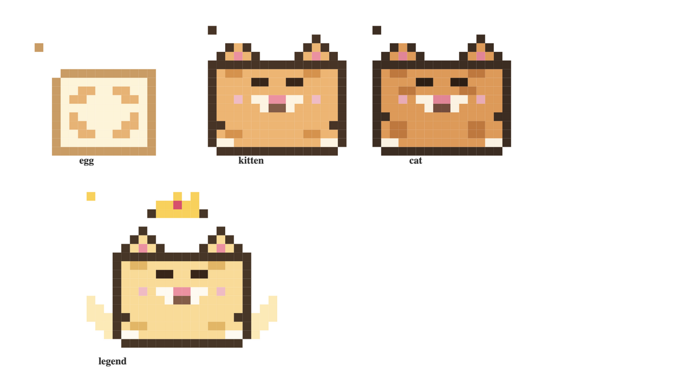

# 🐾 云宠物 CloudPet

一只住在云上的电子宠物: **投喂、玩耍、升级、进化**, 它会随真实时间饿肚子、想主人。纯代码绘制的像素画, 无任何图片/音频素材, 一个 Docker 镜像即可部署到阿里云。


## 玩法

- **领养**: 第一次打开给它起个名字, 得到一颗宠物蛋 🥚; 也可以上传一张**自定义形象图片**(可选, 自动压缩到 512px)
- **多宠物**: 右上角「🐾 宠物列表」, 所有宠物都存在服务器上, 任何浏览器/设备打开看到的都是同一群, 随时切换、放生、再领养
- **投喂**: 6 种食物, 从免费小饼干到豪华龙虾大餐, 涨饱食/心情/经验, 花金币
- **玩耍**: 涨心情、赚金币, 30 秒冷却
- **升级**: 经验攒满自动升级, 升级发金币奖励
- **进化**: Lv.5 幼猫 → Lv.10 灵猫 → Lv.20 神兽(带皇冠和翅膀!); 自定义形象的宠物外观不变, 只升级
- **时间流逝**: 饱食度和心情随真实时间衰减, 饿肚子时心情掉得更快, 记得常回来看它
- 细节: 气泡台词、吃播/眨眼/跳跃动画、爱心与彩带特效、升级横幅、WebAudio 音效、成长日记




## 快速开始

```bash
npm install
npm test        # 16 个单元测试
npm start       # 打开 http://localhost:3000
```

用 Docker:

```bash
docker compose up -d      # 打开 http://localhost:3000
```

预览像素画(终端里看 4 种形态 + 表情):

```bash
npm run preview-art
```

## 技术栈

- **后端**: Node.js + Express, REST API(`/api/pets/*`)
- **存储**: JSON 文件 + 原子写入 + 写串行化(单实例够用, 多实例换 RDS 即可, 见 `src/store.js` 注释)
- **前端**: 原生 HTML/CSS/JS, 零依赖、零图片 —— 宠物是 **box-shadow 像素画**(`public/pet-art.js`), 音效用 WebAudio 合成
- **部署**: Docker 单镜像, 可跑在 ECS/轻量服务器/函数计算 FC/SAE

## 目录结构

```
src/game.js       游戏规则: 食物图鉴/经验曲线/进化表/衰减公式 (纯逻辑, 可单测)
src/store.js      JSON 持久化 (原子写 + 串行化 + 损坏自愈)
src/server.js     Express 服务与 REST API
public/           前端页面 (index.html / app.js / style.css / pet-art.js)
test/             node:test 单元测试
scripts/          preview-art.js 终端预览像素画; probe/verify-png.js 截图校验工具
docs/             阿里云部署指南
.github/workflows GitHub Actions 自动构建推送 ACR
```

## 部署到阿里云

三种方式任选, 完整步骤见 [docs/阿里云部署指南.md](docs/阿里云部署指南.md):

1. **轻量应用服务器/ECS + Docker**(推荐, ¥24/月起): `docker run -p 80:3000 -v pet-data:/app/data …`
2. **函数计算 FC**(几乎免费, 按调用计费, 可缩到 0)
3. **SAE**(企业级免运维)

CI: 把仓库推到 GitHub, 配置 4 个 Secrets, 每次 push 自动构建镜像并推送到阿里云 ACR。

## API 一览

| 方法 | 路径 | 说明 |
|---|---|---|
| GET | `/healthz` | 健康检查 |
| GET | `/api/config` | 食物/进化表/衰减参数 |
| GET | `/api/pets` | 宠物列表(不传 ids 返回全部; `?ids=a,b` 时批量查询) |
| POST | `/api/pets` | 领养 `{name}` |
| GET | `/api/pets/:id` | 读取宠物(自动结算离线衰减) |
| POST | `/api/pets/:id/feed` | 投喂 `{foodId}` |
| POST | `/api/pets/:id/play` | 玩耍(30s 冷却) |
| PATCH | `/api/pets/:id` | 改名 `{name}` |
| PUT | `/api/pets/:id/image` | 上传自定义形象(原始图片字节 ≤3MB, PNG/JPG/GIF/WebP) |
| DELETE | `/api/pets/:id` | 删除宠物(连同形象文件) |

## License

MIT
